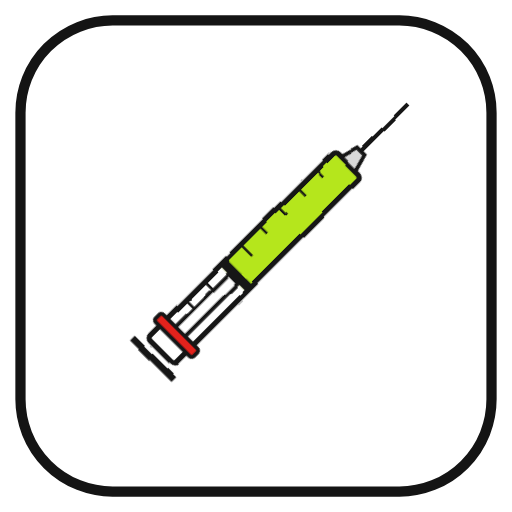

# KONIE KUJĄ

Dziennik treningu na Androida dla kilku kolegów z siłowni. *Chcesz urosnąć? A boisz się igieł?*

## Instalacja na telefonie
1. Na telefonie otwórz stronę **Releases** tego repo i pobierz `konie-kuja.apk` z najnowszego wydania.
2. Otwórz pobrany plik. Android zapyta o zgodę na instalację z przeglądarki: zezwól.
3. Przy pierwszym uruchomieniu wpisz imię.

Aktualizacja: zainstaluj nowy plik na stary. Historia zostaje. Wyjątek: wersje 0.1.1–0.1.4 miały przypadkowy podpis; z nich trzeba raz odinstalować aplikację (najpierw ⋯ → Kopia historii).

## Co robi (wersja 0.1)
- 4 zestawy: PUSH 1, PULL, PUSH 2, NOGI. Kolejny w cyklu podświetlony na czerwono.
- Ciężar na dziś liczony z historii i przerwy (reguły niżej), zawsze do zmiany przyciskami −/+.
- Zapis serii, zamiana ćwiczenia na alternatywę, własne alternatywy.
- Postęp treningu jako strzykawka: im więcej ćwiczeń, tym głębiej wciśnięty tłok.
- Koniec treningu: „Climax.”, trener koń zapala papierosa.
- Historia i rekordy.
- „Przebuduj”: wpisujesz, na co masz ochotę (np. „klata i biceps”), aplikacja składa trening.
- Kopia historii jako tekst do skopiowania i wgrania na innym telefonie.

Wszystkie dane są tylko w telefonie. Aplikacja nie łączy się z internetem.

## Ciężar na dziś
| Dni od ostatniego razu | Ciężar |
|---|---|
| do 10 | ten sam; +2,5 kg (hantle +2 kg) tylko po 3+ treningach i komplecie powtórzeń |
| 11–21 | ten sam |
| 22–42 | −10% |
| 43–90 | −15% |
| ponad 90 | −25% |

## Budowa
GitHub Actions (`.github/workflows/apk.yml`) buduje APK przy każdej zmianie w `www/` na `main` i publikuje go w Releases. Ręcznie: zakładka Actions → „Buduj APK” → Run workflow.

Lokalnie: `npm install`, `npx cap add android`, `cd android && ./gradlew assembleDebug` (wymaga JDK 21 i Android SDK).

## Plan
Plan domyślny jest w `www/plan.js`. Własny plan wgrywa się w aplikacji: ⋯ → Wgraj nowy plan.

## Podpis
`podpis/debug.keystore` to klucz debug Androida (hasło `android`) trzymany w repo, żeby każda wersja miała ten sam podpis i aktualizacja nie wymagała odinstalowania. Workflow wpisuje go wprost do `build.gradle` i po budowie sprawdza odcisk SHA-256 w APK; inny podpis zatrzymuje wydanie. To aplikacja dla znajomych, nie dla sklepu.

## Ikona
Strzykawka jak pasek postępu w aplikacji. Pliki PNG w `ikona/res/` (wszystkie gęstości Androida), generator `ikona/generuj.js` (Playwright). Workflow kopiuje je do projektu Androida przed budową.

## Licencje
Fonty: `www/fonts/LICENCJE.md`.
